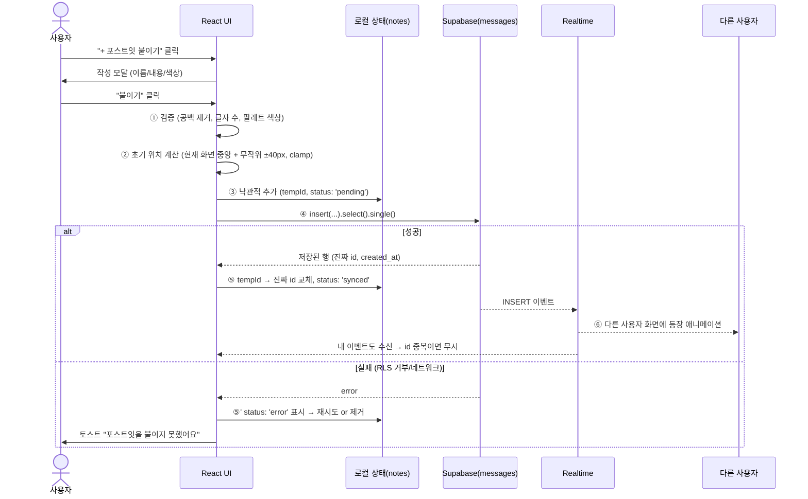
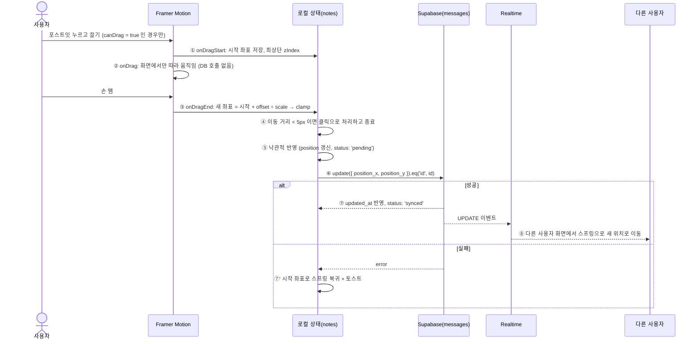

# 디지털 롤링페이퍼 — 보드 & 포스트잇 상호작용 기능 명세서

| 항목 | 내용 |
|---|---|
| 문서 버전 | v1.0 (2026-10-14) |
| 기술 스택 | React (Vite) · Tailwind CSS · Framer Motion · Supabase (`@supabase/supabase-js`) |
| 대상 테이블 | `public.boards`, `public.messages` |
| 관련 파일 | `src/lib/supabase.js`, `supabase/migrations/*.sql` |

---

## 1. 기능 개요

| ID | 기능 | 설명 | 권한 |
|---|---|---|---|
| F-01 | 보드 열람 | `/b/:slug` 로 접속 시 보드와 포스트잇 전체를 불러와 벽에 배치 | 누구나 (공개 보드) |
| F-02 | 포스트잇 작성 | 이름·내용·색상을 입력해 벽에 새 포스트잇을 붙임 | 누구나 (보드가 마감 전일 때) |
| F-03 | 포스트잇 드래그 이동 | 포스트잇을 잡아 끌어 원하는 위치로 옮김 | **작성자 본인** 또는 **보드 주인** |
| F-04 | 실시간 동기화 | 다른 사람이 작성·이동·삭제한 포스트잇이 새로고침 없이 반영 | 누구나 |
| F-05 | 포스트잇 삭제 | 포스트잇 메뉴에서 삭제 | 작성자 본인 또는 보드 주인 |

> [!IMPORTANT]
> RLS 정책상 `messages` UPDATE/DELETE 는 `author_id = auth.uid()` 또는 보드 주인만 가능합니다.
> 따라서 앱 진입 시 `ensureSession()` 으로 **익명 로그인**을 수행해 모든 방문자가 `uid` 를 갖도록 합니다.
> (Supabase 대시보드 → Authentication → Anonymous Sign-ins 활성화 필요)

---

## 2. UI/UX 규칙

### 2-1. 포스트잇 색상 팔레트 (5가지 파스텔 톤)

| 키 | 이름 | HEX (DB 저장값) | Tailwind 임의값 | 글자색 | 비고 |
|---|---|---|---|---|---|
| `lemon` | 레몬 | `#FFF59D` | `bg-[#FFF59D]` | `#5D4F00` | **기본값** (DB default 와 동일) |
| `peach` | 피치 | `#FFCCBC` | `bg-[#FFCCBC]` | `#6D2E1A` | |
| `pink` | 체리블라썸 | `#F8BBD0` | `bg-[#F8BBD0]` | `#6A1B3A` | |
| `mint` | 민트 | `#C8E6C9` | `bg-[#C8E6C9]` | `#1E4620` | |
| `sky` | 스카이 | `#BBDEFB` | `bg-[#BBDEFB]` | `#0D3C61` | |

- 색상 선택 UI: 작성 모달 하단에 지름 28px 원형 스와치 5개, 선택 시 `ring-2 ring-offset-2` + `scale: 1.15` 스프링 애니메이션.
- 글자색은 각 배경과 WCAG AA(4.5:1) 이상 대비를 만족하도록 같은 계열의 진한 색을 사용.
- DB 에는 HEX 문자열을 그대로 저장합니다. 팔레트 외 색상이 들어오면 프런트에서 `lemon` 으로 대체 렌더링합니다.

```js
// src/constants/notePalette.js
export const NOTE_PALETTE = [
  { key: 'lemon', name: '레몬',       bg: '#FFF59D', text: '#5D4F00' },
  { key: 'peach', name: '피치',       bg: '#FFCCBC', text: '#6D2E1A' },
  { key: 'pink',  name: '체리블라썸', bg: '#F8BBD0', text: '#6A1B3A' },
  { key: 'mint',  name: '민트',       bg: '#C8E6C9', text: '#1E4620' },
  { key: 'sky',   name: '스카이',     bg: '#BBDEFB', text: '#0D3C61' },
];
export const DEFAULT_COLOR = '#FFF59D';
```

### 2-2. 글자 수 제한

| 필드 | UI 제한 | DB 제약 (최종 방어선) | 규칙 |
|---|---|---|---|
| 작성자 이름 `author_name` | **1 ~ 20자** | 1 ~ 30자 | 앞뒤 공백 제거 후 검사. 비우면 "익명의 친구" 자동 입력 |
| 내용 `content` | **1 ~ 200자** | 1 ~ 500자 | 앞뒤 공백 제거 후 검사. 줄바꿈 최대 8줄 |

- **글자 수 세는 방법:** `[...str].length` (코드포인트 기준)를 사용해 PostgreSQL `char_length` 와 동일하게 계산합니다. 이모지도 1자로 셉니다.
- **카운터 표시:** 입력창 우측 하단에 `128 / 200` 형태로 표시합니다.
  - 180자 이상: 주황색 경고
  - 200자 도달: 빨간색으로 바뀌고 추가 입력 차단 + 좌우 흔들림(`x: [0,-4,4,0]`) 애니메이션
- 공백만 입력하면 "붙이기" 버튼이 비활성화됩니다.

### 2-3. 보드(벽) 좌표계와 드래그 허용 범위

화면 크기가 달라도 모든 사용자가 **같은 위치**를 보도록 고정 크기의 **논리 캔버스**를 사용합니다.

| 항목 | 값 | 설명 |
|---|---|---|
| 논리 캔버스 크기 | **1600 × 1000** (16:10) | `position_x`, `position_y` 는 이 좌표계의 px 값 (포스트잇 좌상단 기준) |
| 포스트잇 크기 | **200 × 200** | 논리 좌표 기준 고정 |
| 허용 X 범위 | **0 ≤ x ≤ 1400** | `캔버스 폭 − 포스트잇 폭` |
| 허용 Y 범위 | **0 ≤ y ≤ 800** | `캔버스 높이 − 포스트잇 높이` |
| 화면 배율 `scale` | `컨테이너 폭 / 1600`, **최소 0.5 ~ 최대 1.0** | 캔버스 전체에 CSS `transform: scale()` 적용 |
| 모바일 (`scale` < 0.5) | `scale` 0.5 고정 + 가로/세로 스크롤 | 포스트잇 글자가 읽을 수 없을 만큼 작아지는 것을 방지 |

**드래그 동작 규칙**

| 규칙 | 상세 |
|---|---|
| 범위 제한 | Framer Motion `dragConstraints={canvasRef}` + `dragElastic={0.1}` 로 경계 밖에서는 살짝 버티다 튕겨 돌아옴. 저장 직전 `clamp()` 로 한 번 더 보정 |
| 관성 | `dragMomentum={false}` — 손을 떼면 그 자리에 멈춤 (예측 가능한 배치) |
| 드래그 중 효과 | `scale: 1.06`, `rotate: 0`, 그림자 확대(`shadow-2xl`), 커서 `grabbing`, 최상단 `zIndex` |
| 드래그 종료 | 원래 기울기로 복귀, 스프링 `{ stiffness: 400, damping: 30 }` |
| 클릭 vs 드래그 구분 | 이동 거리 **5px 미만**이면 클릭으로 처리 (상세 보기 열기), 5px 이상이면 드래그 |
| 권한 없는 포스트잇 | `drag={false}`, 커서 `default`, 호버 시 "작성자만 옮길 수 있어요" 툴팁 |
| 마감된 보드 (`is_locked`) | 작성 버튼 숨김. 이동은 보드 주인만 가능 |
| 접근성 | 내 포스트잇에 포커스 후 방향키로 10px 이동 (`Shift` 누르면 50px), 이동 후 동일한 저장 로직 실행 |

### 2-4. 포스트잇 시각 요소

| 요소 | 규칙 |
|---|---|
| 기울기 | `id` 해시값으로 **−3° ~ +3°** 를 결정 (DB 컬럼 없이도 모든 사용자에게 같은 각도) |
| 겹침 순서 | 기본 `created_at` 오름차순(최신이 위). 드래그하거나 클릭한 포스트잇은 로컬에서 최상단으로 올림 (DB 저장 안 함) |
| 등장 애니메이션 | `initial={{ scale: 0.6, opacity: 0, y: -20 }}` → `animate={{ scale: 1, opacity: 1, y: 0 }}` (붙이는 느낌) |
| 삭제 애니메이션 | `AnimatePresence` + `exit={{ scale: 0.8, opacity: 0, rotate: 8 }}` |
| 내 포스트잇 표시 | 우측 상단에 작은 핀 아이콘 📌 + 점선 테두리 |
| 상태 표시 | 저장 중: 핀이 반투명하게 깜빡임 / 실패: 빨간 느낌표 + "다시 시도" 버튼 |

---

## 3. 데이터 로직

### 3-1. 보드 진입 (초기 로드)

| 단계 | 처리 | 코드 요약 |
|---|---|---|
| 1 | 세션 확보 (없으면 익명 로그인) | `await ensureSession()` |
| 2 | slug 로 보드 조회 | `supabase.from('boards').select('*').eq('slug', slug).single()` |
| 3 | 보드의 포스트잇 조회 | `supabase.from('messages').select('*').eq('board_id', board.id).order('created_at')` |
| 4 | DB 행 → 프런트 객체 변환 | `toNote(row, currentUserId, boardOwnerId)` (snake_case → camelCase, `isMine`/`canDrag` 계산) |
| 5 | Realtime 채널 구독 | `postgres_changes` · `filter: board_id=eq.${board.id}` · INSERT / UPDATE / DELETE |
| 6 | 화면 이탈 시 구독 해제 | `supabase.removeChannel(channel)` |

### 3-2. 포스트잇 작성 흐름



| 단계 | 처리 내용 | 실패 시 |
|---|---|---|
| ① 검증 | `trim()` → 이름 1~20자 / 내용 1~200자 / 색상이 팔레트에 있는지 확인 | 버튼 비활성화 + 필드 아래 안내 문구 |
| ② 위치 계산 | 사용자가 보고 있는 영역(스크롤 + scale 고려)의 중앙 → 논리 좌표로 변환 → ±40px 무작위 → `clamp(0~1400, 0~800)` | — |
| ③ 낙관적 추가 | `id: 'temp-<uuid>'`, `status: 'pending'` 로 즉시 렌더링 (모달 닫힘) | — |
| ④ DB 저장 | `{ board_id, author_id: uid, author_name, content, color, position_x, position_y }` INSERT | RLS 거부 (마감된 보드 등) → 단계 ⑤' |
| ⑤ 확정 | 응답 행으로 임시 객체를 교체 | — |
| ⑤' 롤백 | `status: 'error'` 로 남겨 "다시 시도 / 삭제" 선택 | 3회 연속 실패 시 자동 제거 |
| ⑥ 전파 | Realtime INSERT 수신 → 이미 같은 `id` 가 있으면 무시, 없으면 추가 | — |

### 3-3. 포스트잇 이동(드래그) 흐름



| 단계 | 처리 내용 | 비고 |
|---|---|---|
| ① 드래그 시작 | `dragStartPos = { x, y }` 저장, 로컬 `zIndex` 최상단 | 권한 없으면 `drag={false}` 라서 시작되지 않음 |
| ② 드래그 중 | Framer Motion 의 `x`, `y` MotionValue 만 변경 | **DB 호출 없음** (네트워크 과부하 방지) |
| ③ 좌표 계산 | `newX = start.x + info.offset.x / scale` → `clamp(newX, 0, 1400)` (Y 는 0~800) | 화면 px → 논리 좌표로 변환 |
| ④ 클릭 판별 | `Math.hypot(dx, dy) < 5` 이면 상세 보기 열고 종료 | |
| ⑤ 낙관적 반영 | 상태의 `position` 즉시 갱신, `status: 'pending'` | 소수점은 `Math.round()` 로 정수 저장 |
| ⑥ DB 저장 | `update({ position_x, position_y })` — 드래그 1회당 **1번만** 요청 | 같은 포스트잇을 연속으로 옮기면 이전 요청 결과는 무시 (요청 순번 비교) |
| ⑦ 확정 | `status: 'synced'` | |
| ⑦' 롤백 | `dragStartPos` 로 스프링 복귀 + "위치를 저장하지 못했어요" 토스트 | |
| ⑧ 전파 | Realtime UPDATE 수신 → `animate={{ x, y }}` 스프링 이동 | 내가 드래그 중인 포스트잇에 온 이벤트는 드래그가 끝날 때까지 보류 |

**동시 편집 충돌 정책:** 마지막 저장이 이깁니다 (Last-Write-Wins).
같은 포스트잇을 옮길 수 있는 사람은 작성자와 보드 주인 둘뿐이라 충돌 가능성이 낮습니다. 그래서 별도의 잠금(lock)은 두지 않습니다.

### 3-4. Realtime 이벤트 처리 규칙

| 이벤트 | 처리 |
|---|---|
| `INSERT` | 같은 `id` 가 있으면 무시 (내가 만든 것), 없으면 등장 애니메이션과 함께 추가 |
| `UPDATE` | 받은 `updated_at` 이 로컬 값보다 최신일 때만 반영 → 위치 변경은 스프링 애니메이션 |
| `DELETE` | 해당 `id` 제거 → `exit` 애니메이션 |
| 연결 끊김 → 재연결 | 3-1 의 3단계(전체 조회)를 다시 실행해 상태 재동기화 |

> [!NOTE]
> Realtime 에서 DELETE 이벤트로 `old` 레코드의 `id` 를 받으려면 기본 설정(Primary Key 포함)으로 충분합니다. 다른 컬럼까지 필요하면 `alter table messages replica identity full;` 이 필요합니다.

---

## 4. 프런트엔드 포스트잇 객체

### 4-1. 필드 정의 (DB ↔ 프런트 매핑)

| 프런트 필드 | 타입 | DB 컬럼 | 설명 |
|---|---|---|---|
| `id` | `string` | `id` | UUID. 저장 전에는 `temp-` 접두사 |
| `boardId` | `string` | `board_id` | 소속 보드 |
| `authorId` | `string \| null` | `author_id` | 작성자 uid |
| `authorName` | `string` | `author_name` | 표시 이름 |
| `content` | `string` | `content` | 본문 |
| `color` | `string` | `color` | 팔레트 HEX |
| `position` | `{ x: number, y: number }` | `position_x`, `position_y` | 논리 캔버스 좌표 |
| `createdAt` | `string (ISO 8601)` | `created_at` | |
| `updatedAt` | `string (ISO 8601)` | `updated_at` | Realtime 최신 여부 비교용 |
| `rotation` | `number` | — (UI 전용) | `id` 해시로 계산한 기울기 (−3 ~ 3) |
| `isMine` | `boolean` | — (UI 전용) | `authorId === 현재 uid` |
| `canDrag` | `boolean` | — (UI 전용) | `isMine` 또는 보드 주인 여부 |
| `status` | `'synced' \| 'pending' \| 'error'` | — (UI 전용) | 저장 상태 |

### 4-2. JSON 가짜 데이터 예시

```json
[
  {
    "id": "7c9e6679-7425-40de-944b-e07fc1f90ae7",
    "boardId": "3f2b8a10-5d4e-4c3a-9b1f-2e7d6c5a4b30",
    "authorId": "a1b2c3d4-e5f6-4789-abcd-1234567890ab",
    "authorName": "지민",
    "content": "민수야 생일 축하해! 🎂 올해도 같이 맛있는 거 많이 먹으러 다니자!",
    "color": "#FFF59D",
    "position": { "x": 120, "y": 80 },
    "createdAt": "2026-10-14T05:12:03.481Z",
    "updatedAt": "2026-10-14T05:12:03.481Z",
    "rotation": -2.1,
    "isMine": true,
    "canDrag": true,
    "status": "synced"
  },
  {
    "id": "e4d909c2-90d0-4b7a-8f3c-1a2b3c4d5e6f",
    "boardId": "3f2b8a10-5d4e-4c3a-9b1f-2e7d6c5a4b30",
    "authorId": "f9e8d7c6-b5a4-4321-9876-0fedcba98765",
    "authorName": "서연",
    "content": "항상 웃게 해줘서 고마워 💕\n앞으로도 잘 부탁해!",
    "color": "#F8BBD0",
    "position": { "x": 480, "y": 210 },
    "createdAt": "2026-10-14T05:20:47.102Z",
    "updatedAt": "2026-10-14T05:31:15.930Z",
    "rotation": 1.4,
    "isMine": false,
    "canDrag": false,
    "status": "synced"
  },
  {
    "id": "0b1c2d3e-4f50-4a6b-8c7d-9e0f1a2b3c4d",
    "boardId": "3f2b8a10-5d4e-4c3a-9b1f-2e7d6c5a4b30",
    "authorId": null,
    "authorName": "익명의 친구",
    "content": "늘 응원하고 있어요 🍀",
    "color": "#C8E6C9",
    "position": { "x": 900, "y": 560 },
    "createdAt": "2026-10-14T05:25:09.664Z",
    "updatedAt": "2026-10-14T05:25:09.664Z",
    "rotation": 2.8,
    "isMine": false,
    "canDrag": false,
    "status": "synced"
  },
  {
    "id": "temp-5a6b7c8d-9e0f-4123-8456-789abcdef012",
    "boardId": "3f2b8a10-5d4e-4c3a-9b1f-2e7d6c5a4b30",
    "authorId": "a1b2c3d4-e5f6-4789-abcd-1234567890ab",
    "authorName": "지민",
    "content": "하나 더! 다음 주 파티 장소는 비밀 🤫",
    "color": "#BBDEFB",
    "position": { "x": 1400, "y": 800 },
    "createdAt": "2026-10-14T05:46:30.000Z",
    "updatedAt": "2026-10-14T05:46:30.000Z",
    "rotation": -0.7,
    "isMine": true,
    "canDrag": true,
    "status": "pending"
  }
]
```

> 4번째 객체는 **저장 중(낙관적 추가)** 상태의 예시입니다. 위치 `(1400, 800)` 은 드래그 허용 범위의 최대값(우측 하단 끝)입니다.

### 4-3. 변환 함수 예시

```js
// src/lib/noteMapper.js
const hashRotation = (id) => {
  let h = 0;
  for (const ch of id) h = (h * 31 + ch.charCodeAt(0)) | 0;
  return Math.round(((Math.abs(h) % 61) / 10 - 3) * 10) / 10; // -3.0 ~ 3.0
};

export const toNote = (row, currentUserId, boardOwnerId) => {
  const isMine = !!currentUserId && row.author_id === currentUserId;
  return {
    id: row.id,
    boardId: row.board_id,
    authorId: row.author_id,
    authorName: row.author_name,
    content: row.content,
    color: row.color,
    position: { x: row.position_x, y: row.position_y },
    createdAt: row.created_at,
    updatedAt: row.updated_at,
    rotation: hashRotation(row.id),
    isMine,
    canDrag: isMine || currentUserId === boardOwnerId,
    status: 'synced',
  };
};
```

---

## 5. 컴포넌트 구조 (제안)

| 컴포넌트 | 역할 |
|---|---|
| `BoardPage` | slug 로 보드 로드, 세션 확보, `useBoardNotes` 훅 연결 |
| `BoardCanvas` | 1600×1000 논리 캔버스, `scale` 계산, 드래그 경계(`ref`) 제공 |
| `StickyNote` | `motion.div` 포스트잇, 드래그·애니메이션·권한 처리 |
| `NoteComposerModal` | 작성 폼 (이름·내용·색상, 글자 수 카운터) |
| `ColorPicker` | 5색 팔레트 스와치 |
| `useBoardNotes(boardId)` | 조회·작성·이동·삭제·Realtime 구독을 담당하는 커스텀 훅 |
| `Toast` | 저장 실패 등 피드백 |

## 6. 예외 상황 정리

| 상황 | 처리 |
|---|---|
| 존재하지 않는 slug / 비공개 보드 | "보드를 찾을 수 없어요" 빈 화면 + 홈으로 버튼 |
| 익명 로그인 비활성화 상태 | 작성은 가능하지만 `author_id = null` → 이동·삭제 불가 안내 |
| 마감된 보드에 작성 시도 | RLS 가 INSERT 거부 → "작성이 마감된 보드예요" 토스트 |
| 오프라인 | 상단 배너 "연결이 끊겼어요", 작성·이동 버튼 비활성화, 재연결 시 재동기화 |
| 포스트잇 100개 초과 | 화면 밖 포스트잇은 그림자 효과 생략 (성능) |
